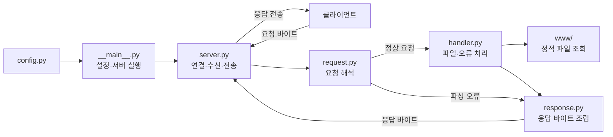
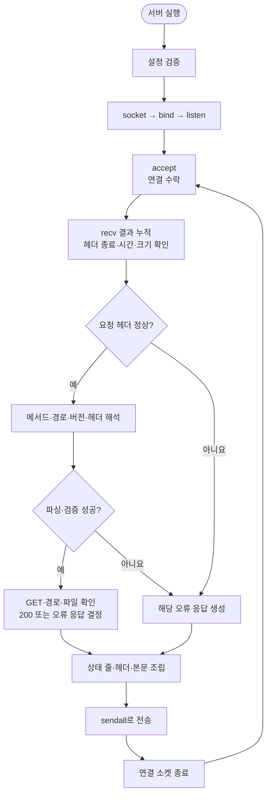
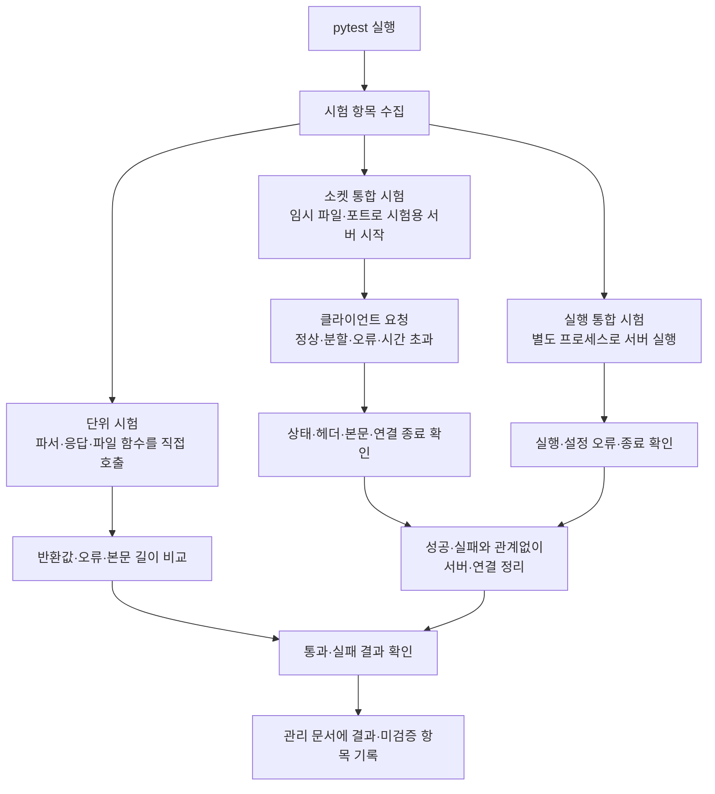

# Raw Server 프레젠테이션 원고

진행자: 한국공학대학교 컴퓨터전자공학과 2024531046 윤대현  
교육 주제: OJT 프로젝트 관리 실무  
실습 주제: 프레임워크 없는 Python Socket 기반 HTTP 서버 구현

각 항목은 PPT에 넣을 핵심 내용과 발표할 대본으로 구성한다. 디렉터리는 현재 프로젝트 구조를 기준으로 작성했으며, 실행·시험·프로젝트 관리 흐름은 각각 구분하였다.

## 프레젠테이션 목차

1. [기본 정보](#1-기본-정보)
2. [Raw Server 제작 이유](#2-raw-server-제작-이유)
3. [이론 - 네트워크 7계층](#3-이론---네트워크-7계층)
4. [이론 - TCP 프로그래밍](#4-이론---tcp-프로그래밍)
5. [실습 - 디렉터리 다이어그램](#5-실습---디렉터리-다이어그램)
6. [실습 - 플로우 다이어그램](#6-실습---플로우-다이어그램)
7. [관리 - 프로젝트 관리 사항](#7-관리---프로젝트-관리-사항)
8. [감사합니다](#8-감사합니다)

## 1. 기본 정보

### 슬라이드 내용

**Raw Server**  
프레임워크 없이 서버를 만들며 배우는 네트워크와 프로젝트 관리

- 진행자: 윤대현
- 소속: 한국공학대학교 컴퓨터전자공학과
- 학번: 2024531046
- 교육: OJT 프로젝트 관리 실무
- 구현: Python 표준 라이브러리의 TCP Socket 기반 미니 HTTP 서버

### 발표 대본

안녕하세요. 한국공학대학교 컴퓨터전자공학과 2024531046 윤대현입니다.

이번 발표에서는 OJT 프로젝트 관리 실무 교육의 실습으로 진행한 Raw Server 프로젝트를 소개하겠습니다. 먼저 서버를 만들게 된 이유와 네트워크 이론을 설명하고, 실제 코드 구조와 실행·시험 흐름, 그리고 프로젝트를 관리한 방법을 말씀드리겠습니다.

## 2. Raw Server 제작 이유

### 슬라이드 내용

- OJT의 주제는 프로젝트 관리 실무이다.
- 실제 프로젝트를 통해 계획·수행·통제·변경 관리를 경험하고자 했다.
- 4주차 네트워크 7계층 학습과 연결하여 서버 개발을 실습 주제로 선택했다.
- 프레임워크가 처리하는 요청 수신·파싱·응답 생성을 직접 구현했다.
- 목표는 네트워크 프로그래밍과 프로젝트 관리를 함께 배우는 것이다.

**기술 목표:** 바이트 수신부터 HTTP 응답·연결 종료까지 이해  
**관리 목표:** 요구사항 → 작업 분해 → 구현 → 시험 → 개선 기록 연결

### 발표 대본

OJT의 주제는 프로젝트 관리 실무입니다. 프로젝트 관리를 배우려면 실제로 수행하면서 계획과 결과를 비교할 수 있는 프로젝트가 필요하다고 생각했습니다.

4주차 네트워크 7계층 학습과 연결할 수 있는 주제로 Raw Server를 선택했습니다. 프레임워크를 사용하면 쉽게 서버를 만들 수 있지만, 이번에는 연결을 받고 요청을 해석하고 응답을 만드는 과정을 직접 확인하고 싶었습니다.

이를 통해 네트워크 프로그래밍을 배우는 동시에, 필요한 기능을 정하고 작업을 나누며 시험으로 완료 여부를 판단하는 프로젝트 관리도 함께 실습하는 것이 목표입니다.

이 프로젝트에서 Raw는 TCP 소켓 위에 HTTP 처리를 직접 구현한다는 의미입니다. 운영체제의 TCP/IP 기능은 사용하며, IP 패킷 자체를 만드는 Raw Socket인 SOCK_RAW를 사용하는 것은 아닙니다.

## 3. 이론 - 네트워크 7계층

### 슬라이드 내용: 계층별 역할

OSI 7계층은 네트워크 통신의 역할을 나누어 이해하기 위한 참조 모델이다.

| 계층 | 이름 | 주요 역할 및 예시 |
| --- | --- | --- |
| 7 | 응용 계층 | 애플리케이션이 사용하는 통신 규칙. 예: HTTP |
| 6 | 표현 계층 | 데이터 표현·인코딩·압축·암호화에 관한 기능 |
| 5 | 세션 계층 | 애플리케이션 사이의 대화·세션 관리 기능 |
| 4 | 전송 계층 | TCP·UDP와 포트를 통한 통신 종단 구분 및 데이터 전달 |
| 3 | 네트워크 계층 | IP 주소와 라우팅을 통한 네트워크 간 패킷 전달 |
| 2 | 데이터 링크 계층 | 같은 링크에서 프레임 전달. Ethernet에서는 MAC 주소 사용 |
| 1 | 물리 계층 | 비트를 전기·광·무선 신호로 전달. PHY는 관련 하드웨어 예시 |

OSI는 기능을 구분하는 모델이며, 실제 TCP/IP 구현이 항상 7개의 독립 모듈이나 헤더로 구성되는 것은 아니다. [IBM OSI 설명](https://www.ibm.com/think/topics/osi-model), [IBM 네트워크 문서](https://www.ibm.com/docs/en/aix/7.1.0?topic=networks-)

### 슬라이드 내용: 캡슐화

송신 시 상위 계층 데이터를 하위 계층의 데이터 영역에 담고 필요한 제어 정보를 붙인다. 수신 측에서는 반대 방향으로 해석한다.

```text
응용 데이터: HTTP 요청 또는 응답 바이트
       ↓ TCP가 스트림을 나누어 전송
TCP 세그먼트: [ TCP 헤더 | 데이터 일부 ]
       ↓
IP 패킷:      [ IP 헤더 | TCP 세그먼트 ]
       ↓
Ethernet:     [ MAC 헤더 | IP 패킷 | FCS ]
       ↓
물리 신호: 전기·광·무선 신호로 전달
```

위 그림은 일반적인 Ethernet 기반 TCP/IP 통신을 단순화한 것이다. HTTP 요청 하나가 여러 TCP 세그먼트로 나뉠 수 있다. 링크 계층이 상위 데이터를 프레임으로 감싸는 개념은 [IBM 네트워크 문서](https://www.ibm.com/docs/en/aix/7.1.0?topic=networks-)를 참고한다.

MAC 주소를 이용한 특정 수신자 대상 통신은 유니캐스트이며, Ethernet에는 브로드캐스트·멀티캐스트도 있다. 따라서 데이터 링크 계층 전체를 1:1 통신만 담당한다고 설명하지 않는다. [Cisco Catalyst 관리 문서](https://www.cisco.com/c/en/us/td/docs/switches/campus-lan-switches-access/Catalyst-1200-and-1300-Switches/Admin-Guide/catalyst-1200-admin-guide.pdf)

### 슬라이드 내용: MTU와 소프트웨어

- MTU는 링크에서 전달할 수 있는 최대 패킷 크기를 이해하는 기준이다.
- 일반적인 Ethernet의 IP MTU는 **1500바이트**이며 MAC 헤더·FCS는 제외한다.
- 1500바이트가 모든 네트워크의 절대 최대값은 아니다. 링크·장비·설정에 따라 달라진다.
- TCP가 전달하는 데이터 크기는 IP·TCP 헤더와 경로 조건 등의 영향을 받는다.
- `recv(4096)`의 4096은 한 번에 받을 수 있는 최대 바이트 수이며 MTU 설정이 아니다.

기본 헤더만 고려한 IPv4/TCP 예시는 다음과 같다.

```text
Ethernet IP MTU 1500바이트
= IPv4 헤더 20 + TCP 헤더 20 + TCP 데이터 1460
```

1460바이트는 옵션 없는 기본 헤더를 가정한 계산 예시다. TCP 옵션이나 다른 경로 조건이 있으면 실제 데이터 크기는 달라질 수 있다. [RFC 894 정오표](https://www.rfc-editor.org/errata_search.php?rfc=894), [RFC 6691: TCP Options and MSS](https://www.rfc-editor.org/rfc/rfc6691.html)

MTU는 운영체제·장비 설정에도 관련되며, 소프트웨어는 이를 고려해 전송한다. 그러나 HTTP 요청 경계나 Python 수신 버퍼 크기와 동일하지 않다. Jumbo Frame 지원과 MTU 변경은 링크·장비의 지원 범위를 확인해야 한다. [Cisco MTU 설명](https://www.cisco.com/c/en/us/support/docs/switches/catalyst-6000-series-switches/24048-148.html)

### 발표 대본

네트워크 7계층은 통신 과정의 역할을 나누어 이해하는 모델입니다. 물리 계층은 실제 신호를 전달하고, 데이터 링크 계층은 같은 링크에서 프레임을 전달합니다. Ethernet에서는 MAC 주소를 사용하며, 특정 장치에 보내는 유니캐스트 외에 여러 장치에 전달하는 방식도 있습니다.

네트워크 계층은 IP 주소와 경로를 이용해 패킷을 전달하고, 전송 계층은 TCP나 UDP와 포트를 사용합니다. 상위 계층에서는 세션, 데이터 표현, HTTP 같은 애플리케이션 통신 규칙을 다룹니다.

데이터가 내려갈 때는 TCP, IP, Ethernet 정보가 붙습니다. 이것이 캡슐화입니다. 다만 HTTP 요청 하나와 TCP 세그먼트 하나가 항상 같은 것은 아닙니다.

일반적인 Ethernet의 IP MTU는 1500바이트입니다. 기본 IPv4와 TCP 헤더를 제외하면 데이터 영역은 1460바이트가 되는 예를 볼 수 있습니다. 하지만 이 값이 프로그램에서 한 번에 읽는 크기를 정해주지는 않습니다. 그래서 서버는 한 번의 recv 결과를 요청 전체로 가정하지 않고 데이터를 모아 해석해야 합니다.

이번 로컬 시험의 127.0.0.1 통신은 루프백을 사용합니다. 여기서 설명한 Ethernet·PHY 흐름을 실제 장비에서 확인하는 LAN 접속과 패킷 관찰은 후속 실습으로 구분했습니다.

## 4. 이론 - TCP 프로그래밍

### 슬라이드 내용

| 구분 | 서버 | 클라이언트 |
| --- | --- | --- |
| 주소 지정 | 수신할 로컬 IP·포트를 bind에 지정 | 접속할 서버의 목적지 IP·포트를 connect에 지정 |
| 로컬 바인딩 | 이 프로젝트는 bind를 명시적으로 호출 | 일반적으로 운영체제가 로컬 주소·임시 포트를 자동 선택 |
| 연결 역할 | listen 후 accept로 연결 수락 | connect로 연결 시도 |
| 데이터 처리 | recv로 요청 수신, sendall로 응답 전송 | 요청 전송 후 응답 수신 |

```text
서버: socket → bind → listen → accept → recv / sendall → close
클라이언트: socket → connect → sendall / recv → close

연결 예시:
클라이언트 127.0.0.1:52340  ↔  서버 127.0.0.1:8000
                       ↑
         52340은 운영체제가 선택한 임시 포트의 예시
```

클라이언트도 통신에 사용할 로컬 주소·포트가 필요하다. 보통 명시적인 bind 호출을 생략하면 운영체제가 자동 처리하며, 특정 로컬 IP·포트를 사용해야 할 때는 직접 bind할 수 있다. 서버는 수신 대기 소켓을 유지하고 accept로 얻은 연결 소켓에서 데이터를 주고받는다. [Linux TCP 매뉴얼](https://man7.org/linux/man-pages/man7/tcp.7.html)

### 발표 대본

서버는 클라이언트가 찾아올 수 있도록 수신할 IP와 포트를 정합니다. 이 프로젝트는 bind로 주소를 연결한 다음 listen으로 연결을 기다리고, accept로 연결 소켓을 받습니다.

클라이언트는 접속할 서버의 IP와 포트를 connect에 전달합니다. 클라이언트의 로컬 IP와 포트는 일반적으로 운영체제가 선택하므로 직접 bind를 호출하지 않아도 됩니다. 따라서 클라이언트에는 바인딩 자체가 없다는 뜻이 아니라, 보통 운영체제가 자동 처리한다는 뜻입니다.

연결이 성립하면 서버와 클라이언트 모두 데이터를 보내고 받을 수 있습니다. 이번 서버는 요청을 모아 HTTP 응답을 보낸 뒤 해당 연결을 닫고, 수신 대기 소켓으로 다음 연결을 받습니다.

TCP는 바이트 스트림이므로 보내는 횟수와 받는 횟수가 같다고 가정할 수 없습니다. 서버 코드에서는 헤더 종료 구분자를 찾을 때까지 수신 결과를 누적합니다. [Linux TCP 매뉴얼](https://man7.org/linux/man-pages/man7/tcp.7.html)

## 5. 실습 - 디렉터리 다이어그램

### 슬라이드 내용: 주요 디렉터리

아래는 현재 프로젝트의 주요 파일을 추린 구조다. 보고서와 발표 자료는 각각 OJT/REPORT와 OJT/PPT에 위치한다.

```text
OJT_MANAGE/
├── README.md                         # 프로젝트 실행·시험 안내
├── pyproject.toml                    # 패키지·Python·pytest 설정
├── src/mini_http/                    # HTTP 서버 구현
│   ├── __init__.py                   # 패키지 설명
│   ├── __main__.py                   # 실행 진입점
│   ├── config.py                     # 주소·포트·제한 설정
│   ├── server.py                     # TCP 연결·수신·전송·정리
│   ├── request.py                    # HTTP 요청 해석·검증
│   ├── handler.py                    # URL·파일·오류 처리
│   └── response.py                   # 응답 바이트 조립
├── examples/
│   └── tcp_echo_server.py            # TCP 송수신 기초 실습
├── www/                             # 클라이언트에 제공할 파일
│   ├── index.html                    # 기본 페이지
│   ├── 404.html                      # 없는 경로 안내
│   └── assets/
│       ├── css/style.css             # 페이지 스타일
│       └── images/connection.svg     # 네트워크 설명 이미지
├── tests/
│   ├── unit/
│   │   ├── test_request.py           # 요청 파서 시험
│   │   ├── test_response.py          # 응답·본문 길이 시험
│   │   └── test_handler.py           # 파일·경로·MIME 시험
│   ├── integration/
│   │   └── test_http_server.py       # 실제 소켓·실행 통합 시험
│   └── fixtures/
│       ├── valid_get.txt             # 정상 요청 자료
│       └── malformed_request.txt     # 비정상 요청 자료
├── docs/
│   ├── ojt_manage_planning.md        # 요구사항·WBS·위험·시험·변경
│   ├── ojt_manage_run_server         # 서버 실행 스크립트
│   ├── ojt_manage_run_client         # curl 접속 스크립트
│   ├── ojt_manage_server_command.md  # 서버·시험 명령 안내
│   └── ojt_manage_client_command.md  # 클라이언트 명령 안내
└── OJT/
    ├── REPORT/                      # 계획·수행·통제·기술 보고서
    │   ├── ojt_manage_plan.md
    │   ├── ojt_manage_dir_diagram.md
    │   ├── ojt_manage_flow_diagram.md
    │   └── ojt_manage_raw_server_report.md
    └── PPT/
        └── ppt_manuscript.md         # 현재 발표 원고
```

### 슬라이드 내용: 서버 모듈 관계



화살표는 처리 관계를 단순화한 것이다. 실제로는 server.py가 파서·핸들러를 호출하고 응답 객체를 받아 전송한다.

### 발표 대본

프로젝트는 크게 서버 소스, 정적 파일, 시험 코드, 관리 문서로 나누었습니다.

서버 소스에서는 server.py가 네트워크 연결을 담당하고, request.py가 요청을 해석합니다. handler.py는 경로에 맞는 파일과 상태를 결정하고, response.py가 HTTP 응답을 바이트로 만듭니다. __main__.py와 config.py는 서버 시작과 설정을 담당합니다.

이렇게 나누면 네트워크 연결 없이도 파서나 응답 생성 기능을 시험할 수 있습니다. 관리 측면에서도 기능별 작업과 완료 기준을 나누기 쉬워집니다. docs에는 실행 방법과 통합 관리 기록을, OJT 폴더에는 보고서와 발표 자료를 정리했습니다.

근거: [서버 소스](../../src/mini_http/server.py), [프로젝트 관리 기록](../../docs/ojt_manage_planning.md), [구조 설명 문서](../REPORT/ojt_manage_dir_diagram.md). 위 트리는 기존 설명 문서의 이전 배치보다 현재 파일 위치를 우선하여 작성했다.

## 6. 실습 - 플로우 다이어그램

### 슬라이드 내용: 서버 실행 흐름



주요 처리 경로를 표현한 그림이다. 빈 연결 종료나 전송 중 단절 등은 연결을 정리하고 다음 요청을 받는다. Ctrl+C로 서버를 종료하면 수신 대기 소켓도 정리한다. [실제 서버 구현](../../src/mini_http/server.py)

### 슬라이드 내용: 자동 시험 흐름



이 그림의 분기는 시험 유형의 구분이며 병렬 실행을 의미하지 않는다. 일반적인 단위 시험은 수동 서버가 필요 없고, 통합 시험은 필요한 서버 시작·종료를 시험 코드가 처리한다. 마지막 관리 문서 갱신은 결과를 확인한 뒤 수행하는 작업이며 pytest가 자동 작성하지 않는다. [통합 시험 코드](../../tests/integration/test_http_server.py)

### 시연 명령

```bash
# 터미널 1: 서버 시작
/home/yoondh/work/OJT_MANAGE/docs/ojt_manage_run_server
```

```bash
# 터미널 2: 정상 응답과 없는 경로 확인
/home/yoondh/work/OJT_MANAGE/docs/ojt_manage_run_client
/home/yoondh/work/OJT_MANAGE/docs/ojt_manage_run_client http://127.0.0.1:8000/not-found
```

```bash
# 자동 시험: 별도 수동 서버 없이 실행 가능
cd /home/yoondh/work/OJT_MANAGE
.venv/bin/python3 -m pytest tests/ -q
```

정상 경로는 200과 HTML 본문, 없는 경로는 404를 확인한다. 클라이언트 스크립트는 curl이 필요하며 응답을 출력하고 종료한다. 서버 종료는 Ctrl+C다.

### 발표 대본

실행 흐름에서는 먼저 설정을 확인하고 소켓을 준비합니다. 연결을 받으면 데이터를 모아 HTTP 요청을 해석하고 파일 또는 오류 응답을 결정합니다. 응답은 상태 줄, 헤더와 본문을 합쳐 보내며, 처리한 연결은 닫고 다음 연결을 기다립니다.

시험 흐름은 단위 시험과 통합 시험으로 나누었습니다. 단위 시험은 함수의 결과를 직접 확인하고, 통합 시험은 실제 소켓 연결과 별도 실행 프로세스를 검증합니다. 시험용 서버는 테스트가 자동으로 시작하고 정리하므로 매번 수동으로 서버를 띄울 필요가 없습니다.

정상 페이지가 나오는지만 확인하지 않고, 요청이 나누어 도착하거나 잘못된 요청이 들어온 뒤에도 서버가 계속 동작하는지 확인했습니다. 시험 결과는 관리 기록에 반영하여 완료된 항목과 아직 검증하지 않은 항목을 구분했습니다.

## 7. 관리 - 프로젝트 관리 사항

### 슬라이드 내용

**관리 흐름:** 목표·범위 정의 → WBS 작성 → 구현 → 시험·위험 점검 → 변경 기록 → 잔여 항목 확인

| 관리 사항 | 실제 적용 내용 | 확인할 산출물 |
| --- | --- | --- |
| 요구사항·범위 | 정적 GET·IPv4·순차 처리를 필수 범위로 정하고 확장 기능 구분 | REQ-001~012와 완료 기준 |
| 작업·일정 | Echo·요청 파서·응답·연결·검증으로 작업 및 선행 관계 분해 | WBS-001~011과 주차 계획 |
| 품질·진척 | 기능별 단위 시험과 실제 연결 시험으로 완료 여부 확인 | 구현 코드·시험 결과·미검증 목록 |
| 위험·이슈 | 분할 수신, 느린 입력, 한글 길이, 경로 탈출에 대응 | 위험표·제한 처리·관련 시험 |
| 변경 관리 | 실행 스크립트·문서 보완, 추가 기능의 영향 분석 양식 준비 | 변경 기록·CR 양식·실행 안내 |
| 종료 관리 | 코드 완료와 실제 기기·승인·발표 완료 상태 구분 | LAN 검증 양식·최종보고 초안 |

**현재 확인 결과**

- 앞선 2026년 9월 10일 검증: 자동 시험 77개 통과, 실패 0개.
- 구현 및 로컬 자동 검증 기록을 확보했다.
- LAN·스마트폰·브라우저 시각 표시·패킷 관찰은 기록상 미검증이다.
- 실제 주차별 작업 시간, 팀 승인과 최종 종료 기록은 아직 없다.

시험 결과의 근거는 [Raw_Server 보고서](../REPORT/ojt_manage_raw_server_report.md)이며, 15주 교육 일정과 미완료 상태는 [통합 계획 문서](../../docs/ojt_manage_planning.md)를 기준으로 한다. 본 발표 원고 작성 과정에서는 시험을 다시 실행하지 않았다.

### 발표 대본

프로젝트 관리에서 먼저 한 일은 무엇을 만들고 어디까지 만들지를 정한 것입니다. 정적 GET과 순차 처리를 필수 범위로 정하고, 동시 처리나 Keep-Alive는 확장 후보로 구분했습니다.

다음으로 전체 작업을 Echo, 요청 파서, 응답 생성, 연결 처리와 검증으로 나누어 WBS를 작성했습니다. 요구사항은 코드와 시험에 연결했습니다. 예를 들어 기본 페이지 제공은 GET 요청에 200과 한글 HTML이 반환되는 것으로 완료 기준을 정했습니다.

위험도 구현과 시험으로 연결했습니다. 요청이 한 번에 오지 않을 위험에는 분할 수신 시험을, 느린 입력에는 제한 시간을, 경로 탈출에는 문서 루트 검사를 적용했습니다. 실행 편의를 위한 스크립트와 안내 문서도 함께 보완했습니다.

앞선 검증에서 자동 시험 77개가 통과했지만, 이를 프로젝트 전체가 끝났다는 의미로 사용하지 않았습니다. LAN과 실제 기기 시험, 일정 평가, 승인·종료는 별도 상태로 남겼습니다. 이번 실습을 통해 결과물을 만드는 것뿐 아니라 범위를 정하고, 증거로 완료를 판단하며, 남은 작업을 명확히 기록하는 과정을 배웠습니다.

## 8. 감사합니다

### 슬라이드 내용

**감사합니다.**

Raw Server  
한국공학대학교 컴퓨터전자공학과  
2024531046 윤대현

질문 부탁드립니다.

### 발표 대본

이번 Raw Server 프로젝트를 통해 네트워크 요청과 응답의 내부 흐름을 직접 구현하고, 그 과정에 프로젝트 관리 방법을 적용해 보았습니다.

이상으로 발표를 마치겠습니다. 경청해 주셔서 감사합니다. 질문 있으시면 말씀해 주십시오.
