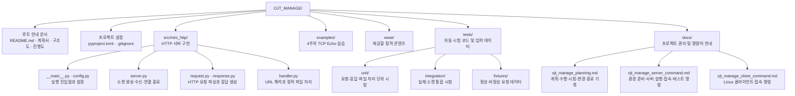
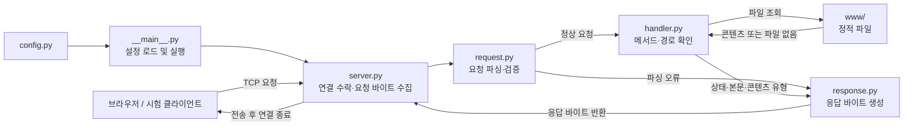

# 프로젝트 디렉터리 구조

기준 문서: [15주차 프로젝트 계획서](./ojt_manage_plan.md) · 연계 문서: [프로젝트 진행 흐름](./ojt_manage_flow_diagram.md)

Python Socket 기반 미니 HTTP 웹 서버를 구현하면서 요구사항, 일정, 시험, 변경 이력을 함께 관리하는 구조다. 아래 구조로 서버·정적 콘텐츠·자동 테스트·관리 문서를 구현했다. 주차별 수업 활동과 실제 기기 검증은 통합 계획 문서에 별도로 기록한다.

## 1. 전체 디렉터리 다이어그램



## 2. 권장 파일 트리

```text
OJT_MANAGE/
├── README.md                       # 설치·실행·시험·시연 방법
├── ojt_manage_plan.md              # 수업 계획서 원본
├── ojt_manage_dir_diagram.md        # 이 문서
├── ojt_manage_flow_diagram.md       # 주차별 진행 및 관리 흐름
├── pyproject.toml                  # Python 버전·패키지·시험 도구 설정
├── .gitignore                      # .venv/, __pycache__/, 임시 결과 등 제외
├── src/
│   └── mini_http/
│       ├── __init__.py
│       ├── __main__.py             # 설정을 읽고 서버 시작
│       ├── config.py               # 바인딩 주소·포트·문서 루트·수신 제한
│       ├── server.py               # TCP 연결 및 요청 수신 흐름
│       ├── request.py              # 요청 라인·헤더 파싱 및 검증
│       ├── response.py             # 상태 라인·헤더·본문 바이트 조립
│       └── handler.py              # URL을 파일에 매핑하고 응답 결정
├── examples/
│   └── tcp_echo_server.py          # HTTP 서버와 별도로 보존할 4주차 실습
├── www/
│   ├── index.html                  # 기본 시연 페이지
│   ├── 404.html                    # 파일 없음 안내 페이지
│   └── assets/
│       ├── css/style.css
│       └── images/
│           └── connection.svg      # MIME 타입 확인용 이미지
├── tests/
│   ├── unit/
│   │   ├── test_request.py
│   │   ├── test_response.py
│   │   └── test_handler.py
│   ├── integration/
│   │   └── test_http_server.py
│   └── fixtures/
│       ├── valid_get.txt
│       └── malformed_request.txt
└── docs/
    ├── ojt_manage_planning.md      # 계획·수행·시험·변경·종료 기록을 한 문서로 관리
    ├── ojt_manage_server_command.md       # 환경 준비·서버 실행·클라이언트 접속·테스트 명령
    └── ojt_manage_client_command.md # Linux curl 접속·응답 확인·HTML 저장 명령
```

`docs/ojt_manage_planning.md`에서 목표·요구사항·WBS·일정·위험, 수행 기록, 시험·결함·네트워크 검증, 변경 이력, 최종 결과·발표 내용을 절별로 관리한다. 실행 방법은 [ojt_manage_server_command.md](./docs/ojt_manage_server_command.md)에 정리한다. 명령어 문서와 계획 통합 문서가 생성되어 있다. 루트의 `ojt_manage_plan.md`는 수업 계획서 원본이다.

Linux 클라이언트 접속 명령은 [ojt_manage_client_command.md](./docs/ojt_manage_client_command.md)에서 확인한다.

## 3. 서버 모듈의 협력 구조



이 그림은 처리 순서를 나타낸다. `server.py`가 각 모듈의 함수를 호출하고 결과를 전달하며, 소켓에 직접 쓰는 책임도 가진다. 파서와 응답 생성기를 소켓에서 분리하면 비정상 요청과 인코딩을 단위 시험으로 확인하기 쉽다.

| 구분 | 권장 책임과 범위 |
| --- | --- |
| `server.py` | `socket → bind → listen → accept` 흐름, 분할 수신 대응, 수신 제한·타임아웃, 전송·연결 정리 |
| `request.py` | 요청 라인·헤더 해석과 유효성 검사. HTTP 전체 표준 지원 여부는 2주차에 범위를 정해 명시 |
| `handler.py` | 기본 `GET` 처리, `/`의 `index.html` 매핑, 파일 존재 확인, 문서 루트 밖 접근 차단 |
| `response.py` | `200`·`404` 및 합의된 오류 응답, MIME 타입, UTF-8 텍스트 인코딩, 본문 바이트 길이 계산 |
| `config.py` | 로컬 실습용 주소와 LAN 시험용 주소·포트를 명시적으로 설정 |
| `tests/` | 자동으로 재현할 시험을 저장. 스마트폰·LAN 수동 시험의 절차와 결과는 `docs/ojt_manage_planning.md`에 기록 |

구현 범위는 정적 파일 `GET`과 `Connection: close`다. Keep-Alive 구현은 선택 변경 후보로 남긴다. 비정상 요청은 `400`, 알려진 미지원 메서드는 `405`와 `Allow: GET`, 모르는 메서드는 `501`을 반환한다. 상세 오류 정책과 제한은 `docs/ojt_manage_planning.md`에 기록했다.

## 4. 구조를 만드는 순서와 이력 관리

| 시점 | 추가·정리할 경로 | 완료 기준 |
| --- | --- | --- |
| 1~3주차 | 루트 안내 문서, 프로젝트 설정, `docs/ojt_manage_planning.md` | 목표·요구사항·작업·일정·시험 기준 합의 |
| 4주차 | `examples/`, `src/mini_http/`의 실행·연결 부분 | Echo 송수신 재현 |
| 5~6주차 | 요청·응답·파일 처리 모듈, `www/`, 관련 `tests/` | 브라우저에서 HTML 및 `404` 확인 |
| 7주차 | 연결 설정, `docs/ojt_manage_planning.md` | localhost·LAN 접속 결과와 v2 기록 |
| 8~11주차 | `docs/ojt_manage_planning.md`, 시험 보강 | 진척·결함·네트워크 검증·중간 평가 기록 |
| 12~14주차 | `docs/ojt_manage_planning.md`, 승인된 코드·시험 수정 | 변경 결정과 통합·회귀시험 결과 추적 |
| 15주차 | `docs/ojt_manage_planning.md`, 최종 `README.md` | 다른 사람이 실행·시험·시연을 재현 |

Git으로 코드와 관리 문서를 함께 관리하고, 버전별 소스 폴더를 복제하지 않는다. 권장 태그는 3주차 `baseline-v1`, 6주차 `v0.1`, 7주차 `v0.2`, 13주차 `baseline-v2`, 15주차 `v1.0`이다. 태그는 해당 완료 기준을 충족한 커밋에 부여한다.

13주차에는 `docs/ojt_manage_planning.md`의 요구사항·WBS·일정 절을 직접 수정하고, 같은 문서의 변경 이력 절에 변경 요약과 관련 커밋·태그를 연결한다. 최초 계획은 `baseline-v1`에서 확인하여 최신 계획과 원본의 혼동을 줄인다.


## 5. tests/에는 무엇을 넣는가?

`tests/`는 서버의 동작이 기대한 결과와 일치하는지 자동으로 확인할 코드를 모아 둘 위치다. 실제 테스트 파일이 구현되어 있으며 통합 테스트는 시험용 서버의 시작과 종료도 수행한다.

| 경로 | 확인할 내용 | 서버 접속 여부 |
| --- | --- | --- |
| `unit/test_request.py` | 요청 라인·헤더 해석, 잘못된 요청 감지 | 서버 실행 없이 파서 함수 시험 |
| `unit/test_response.py` | 상태 코드·헤더·본문 구성, UTF-8 본문 바이트 길이 | 서버 실행 없이 응답 생성 함수 시험 |
| `unit/test_handler.py` | `/`의 파일 매핑, 없는 파일, 문서 루트 밖 접근 처리 | 서버 실행 없이 파일 처리 함수 시험 |
| `integration/test_http_server.py` | 실제 HTTP 요청에 대한 `200`·`404`, 헤더·본문·연결 종료 | 테스트가 시험용 서버를 시작하고 클라이언트로 접속한 뒤 정리 |
| `fixtures/` | 정상·비정상 요청 예시 등 반복해서 사용할 입력 데이터 | 실행 스크립트가 아닌 시험 자료 |

## 6. 클라이언트 입장에서 접속해 보는 방법

현재 제안된 트리에는 **실행 중인 서버에 사용자가 직접 접속하는 독립 클라이언트 스크립트는 없다.** `examples/tcp_echo_server.py`는 서버 실습 코드이고, `tests/integration/test_http_server.py`는 클라이언트 역할을 포함하는 자동 검증 코드다.

서버를 로컬 8000번 포트에서 실행한 뒤에는, 다른 터미널에서 다음 명령으로 GUI 없이 접속할 수 있다. `curl`이 설치되어 있어야 한다.

```bash
# 정상 경로: 상태 줄·헤더·본문 확인
curl -i http://127.0.0.1:8000/

# 없는 경로: 404 응답 확인
curl -i http://127.0.0.1:8000/not-found
```

HTML의 화면 표시를 보려면 브라우저에서 `http://127.0.0.1:8000/`을 연다. 추후 직접 실행할 Python 클라이언트가 필요하면 `scripts/http_client.py`를 추가하여 주소·포트·경로를 입력받고 요청과 응답을 출력하도록 구성할 수 있다. 이 파일은 현재 트리나 실제 프로젝트에 생성된 상태가 아니다.
