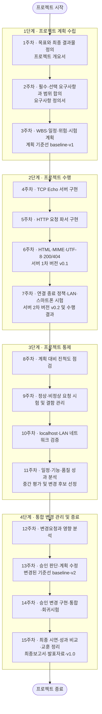
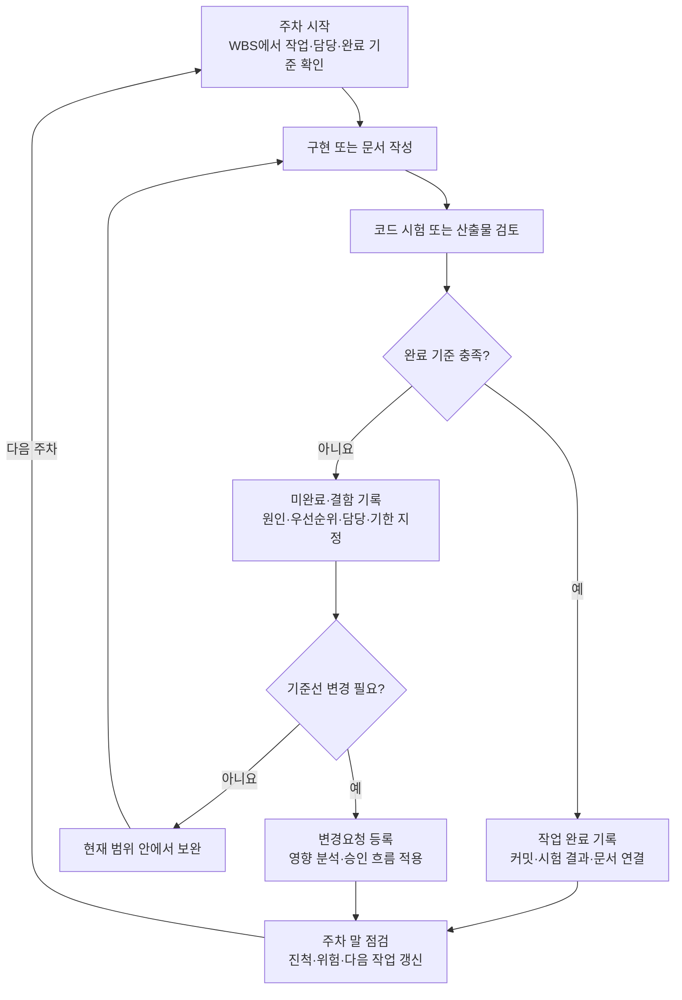
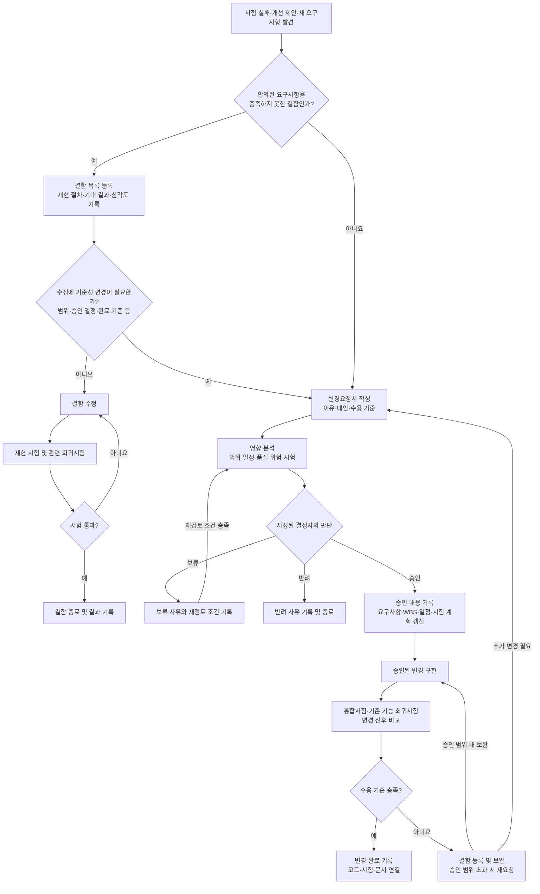
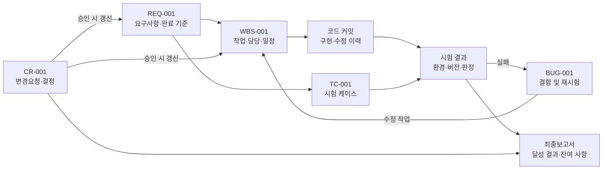

# 프로젝트 진행 흐름 제안

기준 문서: [15주차 프로젝트 계획서](./ojt_manage_plan.md) · 연계 문서: [권장 디렉터리 구조](./ojt_manage_dir_diagram.md)

**목표는 Python Socket 기반 미니 HTTP 웹 서버를 완성하고, 계획·수행·통제·변경·종료 과정을 산출물로 입증하는 것이다.** 주차별 수업은 계획서 순서를 따르되, 시험과 진척 기록은 구현을 시작하는 4주차부터 계속한다. 아래 완료 기준과 운영 방식은 실행을 위한 제안이며 2~3주차에 확정한다.

현재 기본 서버·정적 콘텐츠·자동 테스트가 구현되어 있다. 실제 실행 결과와 미검증 항목은 [통합 계획 및 수행 기록](./docs/ojt_manage_planning.md)에, 사용 방법은 [서버 명령어](./docs/ojt_manage_server_command.md)에 정리했다. 아래 15주 흐름은 수업 운영 계획이며 모든 주차 활동이 완료되었다는 의미는 아니다.

## 1. 15주 전체 진행 다이어그램

이 그림은 수업 순서를 나타낸다. 완료 기준을 충족하지 못한 항목은 미완료로 기록하고 아래 반복 흐름에서 보완한다. 주차가 지났다는 이유로 완료 처리하거나, 지연된 작업 때문에 이후 관리 활동을 생략하지 않는다.

## 2. 주차별 실행·검증·산출물

아래의 **통합 문서**는 `docs/ojt_manage_planning.md`를 뜻한다. 관리 산출물은 이 파일의 절로 통합하고, 코드와 자동 시험은 각 소스 경로에서 관리한다.

| 주차 | 실행할 일 | 완료 판단에 사용할 증거 | 산출물 위치 |
| --- | --- | --- | --- |
| 1 | 목표·사용자·최종 시연 내용 정의 | 무엇을 만들고 성공을 어떻게 판단할지 설명 가능 | 통합 문서의 프로젝트 개요 절 |
| 2 | 필수·선택 기능, 제외 범위, 기술 조사 | 요구사항마다 ID·우선순위·검증 가능한 완료 기준 존재 | 통합 문서의 요구사항·기술 조사 절 |
| 3 | 기능을 작업으로 분해하고 일정·담당·위험·시험 계획 수립 | 필수 요구사항에 작업과 시험 계획이 연결되고 기준선 기록 | 통합 문서의 WBS·일정·위험·시험 계획 절 |
| 4 | TCP Echo 서버 구현 | 클라이언트가 보낸 데이터가 그대로 돌아오는 실행 결과 | `examples/tcp_echo_server.py`, 통합 문서의 구현 기록 절 |
| 5 | 브라우저 요청 관찰, 요청 라인·헤더 파싱 | 정상 요청을 해석하고 합의된 비정상 입력을 감지하는 시험 통과 | `src/mini_http/request.py`, `tests/unit/test_request.py` |
| 6 | HTML·MIME·UTF-8 및 `200`·`404` 응답 구현 | 브라우저의 한글 페이지 표시, 없는 경로 응답, 본문 바이트 길이 확인 | `src/mini_http/`, `www/`, `tests/`, `v0.1` 태그 |
| 7 | HTTP 버전·연결 정책 비교, localhost·LAN·스마트폰 시험 | 연결 종료 및 다른 기기의 접속 결과 기록 | 통합 문서의 수행 결과 절, `v0.2` 태그 |
| 8 | WBS와 실제 수행 결과 비교, 미완료 작업의 조치 결정 | 계획·실제 완료율, 지연 원인·조치·담당·기한이 확인됨 | 통합 문서의 진척도 절 |
| 9 | 정상·비정상 요청, 없는 URL, 지원하지 않는 메서드 시험 | 시험별 기대·실제 결과와 결함 ID 기록, 수정 결함 재시험 | 통합 문서의 시험 케이스·결과·결함 절 |
| 10 | 환경별 IP·포트·연결 상태 검증, 필요 시 패킷 관찰 | localhost·LAN·스마트폰 시험 환경과 성공·실패 원인 기록 | 통합 문서의 네트워크 검증 절 및 증빙 |
| 11 | 일정·기능·품질 성과와 원인 분석 | 결함 보완과 범위 변경 후보를 구분하고 우선순위 제안 | 통합 문서의 중간 평가 절 |
| 12 | 변경요청별 일정·범위·품질 영향 분석 | 변경 이유·대안·추가 작업·시험 영향·예상 일정이 명시됨 | 통합 문서의 변경요청·영향 분석 절 (`CR-001` 등) |
| 13 | 변경 승인·보류·반려 판단, 승인된 계획 수정 | 결정자·근거·일자 기록, 요구사항·WBS·일정 동기화 | 통합 문서의 변경 이력·수정 계획 절, `baseline-v2` |
| 14 | 승인된 변경 구현 및 통합·회귀시험 | 변경 요구사항과 기존 필수 기능의 시험 통과, 변경 전후 비교 | 변경 코드·시험, 통합 문서의 통합·회귀시험 결과 절 |
| 15 | 실행 가이드 정리, 최종 시연·발표·종료 | 최종 완료 기준 확인, 최초 계획과 성과 비교, 잔여 사항 인계 | `README.md`, 통합 문서의 최종보고·발표·교훈 절, `v1.0` 태그 |

6주차와 7주차의 버전 태그는 해당 코드와 문서가 있는 커밋을 가리킨다. LAN 시험을 수행할 수 없는 경우에는 미검증으로 기록하고 대체 일정과 담당자를 지정한다. 13주차 기준선은 실제로 승인된 계획 변경이 있을 때 갱신한다.

## 3. 매주 반복할 작업 관리 흐름

작업 상태는 `대기 → 진행 중 → 검토 중 → 완료`로 관리한다. 검토에 실패하면 진행 중으로 돌리고 결함을 연결한다. 미해결 결함이나 승인 대기 작업이 있어도 주차 말 점검에서 상태와 지연 영향을 기록한다. 인원이 적으면 개발·검토·관리 역할을 겸임하되, 변경 결정자는 3주차에 정한다.

## 4. 결함 수정과 변경 관리 흐름

12~14주차에 이 과정을 집중 실습한다. 그 전에 발생한 결함은 즉시 관리하며, 기준선 변경이 필요한 요청도 같은 절차로 기록·판단한다. 예를 들어 합의된 `404` 응답이 나오지 않는 문제는 결함이고, 초기 범위에 없던 Keep-Alive나 동시 접속 기능 추가는 변경 후보가 된다.

## 5. 요구사항부터 최종 결과까지 추적하기

예를 들어 `REQ-001: GET / 요청에 한글 HTML을 200으로 반환`을 WBS 작업, 구현 커밋, 시험 케이스에 연결한다. 시험 결과에는 실행한 버전과 환경을 남긴다. 이 연결을 바탕으로 8주차에는 실제 진척을, 11주차에는 품질을, 15주차에는 최종 달성 여부를 설명한다.

관리 지표는 단순하게 시작한다. 진척률은 완료 기준을 충족한 WBS 작업 수 ÷ 전체 작업 수로 계산하고, 작업 크기가 크게 다르면 3주차에 합의한 가중치를 적용한다. 시험 결과는 통과·실패·미실행을 따로 집계하며, 결함은 우선순위별 미해결 수와 담당자를 확인한다. 범위가 바뀌면 최초 기준선과 현재 기준선의 차이도 함께 표시한다.

## 6. 단계별 완료 기준

| 점검 시점 | 다음 단계에서 사용할 준비 상태 |
| --- | --- |
| 3주차 말 | 필수·선택·제외 범위, 담당자, 일정, 위험 대응, 시험 기준 및 변경 결정자 확정 |
| 7주차 말 | 기본 서버 동작과 `200`·`404`·UTF-8·MIME·연결 종료 확인, LAN·스마트폰 수행 결과 기록 |
| 11주차 말 | 계획 대비 차이, 시험·결함 현황, 네트워크 검증 결과, 개선 우선순위 정리 |
| 13주차 말 | 각 변경요청의 처리 결정과 근거 기록, 승인된 요구사항·일정·WBS·시험 계획 갱신 |
| 14주차 말 | 승인된 변경과 기존 필수 기능 검증 통과, 최종 시연을 막는 결함 해결 |
| 15주차 종료 | 실행 가능한 최종 버전·실행 안내·시험 결과·보고서·발표자료·교훈 정리 완료 |

종료 시에는 필수 완료 기준을 충족했는지 확인하고, 미반영 선택 기능과 남은 경미한 결함을 제한사항으로 기록한다. 필수 기준에 미달하면 보완하거나 변경 절차로 범위 조정을 결정하고, 변경 이유와 최초 계획 대비 차이를 최종보고서에 남긴다.
